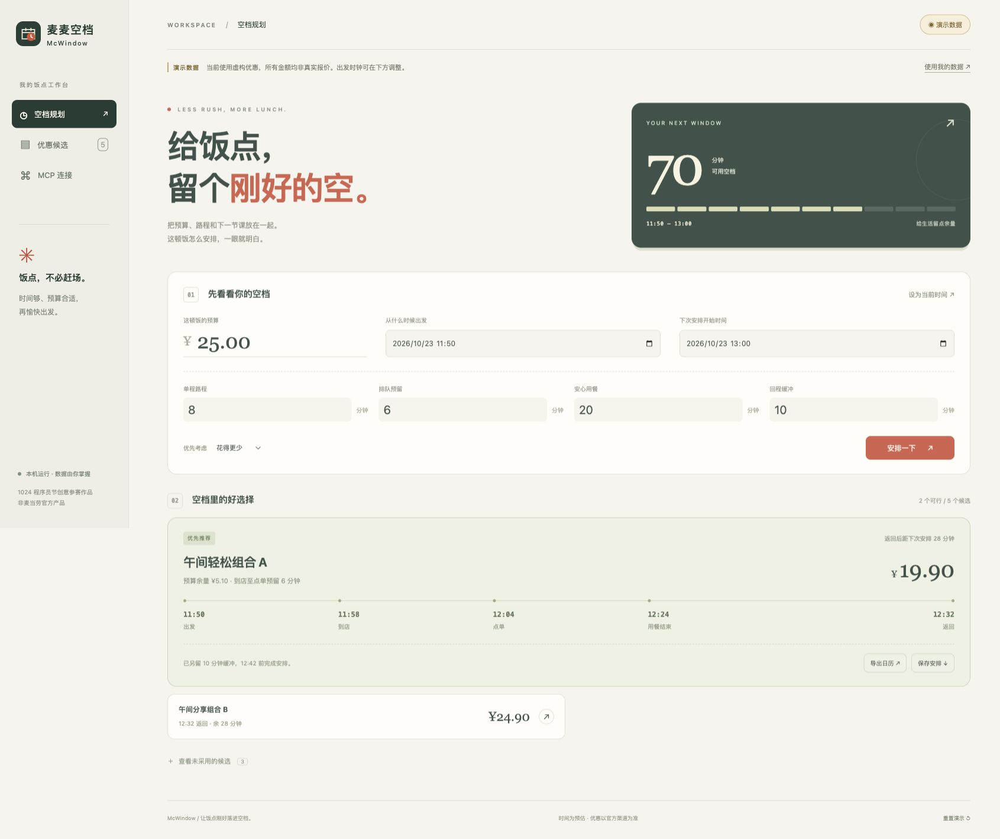

# 麦麦空档 McWindow

**给饭点，留个刚好的空。**

面向课间、会议间隙等时间受限的用餐场景：把预算、往返时间、用餐时间和优惠可用时段放进同一个规划器，回答“现在出发来不来得及，哪一个候选更适合”。

这是一个麦当劳 MCP 创意参赛项目，非麦当劳官方产品。内置资料均为明确标注的虚构演示，不代表真实餐品、价格或优惠。



## 能做什么

- 输入预算、下一项安排开始时间、单程路程、排队、用餐、缓冲时间。
- 检查优惠有效期及每日可用时段，支持跨午夜时段。
- 按最低价格或最早返回排序，展示完整出发/到店/点单/用餐结束/返回时间线。
- 对超预算、已过期、时段不匹配、价格未知、尚未核对条件的候选逐项解释。
- 一键导出 `.ics` 日历和 Markdown 安排。
- 连接麦当劳官方 MCP，获取实时工具定义、查询原文，再由用户核对并建立候选。
- 提供可被 Agent 使用的 `SKILL.md` 及确定性 CLI 规划器。

## 在 Mac 上启动

要求 Python **3.9 或更新版本**；没有第三方运行依赖。

1. 在 Finder 中进入项目文件夹，双击 `start.command`；或在该文件夹运行 `python3 app.py`。
2. 浏览器打开 <http://127.0.0.1:8765>。
3. 默认展示2026年10月23日11:50的固定演示：70分钟空档、25元预算，5个虚构候选中2个可行。

服务仅绑定 `127.0.0.1`。端口占用时运行 `python3 app.py --port 8766`，再打开相应地址。按 Control+C 停止。

## 真实 MCP 使用

1. 访问 [麦当劳官方开放平台](https://open.mcd.cn/mcp)，手机号登录 → 控制台 → 激活 Token，并自行阅读相关协议。
2. 在本机页面的「MCP 连接」中输入 Token，点击「连接并获取工具」。Token 不需要交给开发者或发送到聊天中。
3. 选择 `query-my-coupons`、`available-coupons` 或 `campaign-calendar`，查看实时 `inputSchema`，填写参数后查询。
4. 阅读官方返回原文，点击「依据查询结果建立候选」，录入原文明确的名称、实际应付价格、有效期和时段；核对门店、就餐方式和领取状态。条件不明确时不勾选「已核对」。
5. 保存后回到「空档规划」计算，按需要导出日历。

`available-coupons` 是可领取券列表，不代表已领取；活动日历也不保证有报价。此版本有意采用“原文 → 人工核对 → 结构化候选”，不猜测上游未公开的字段、金额单位或适用条件。Agent Skill 可协助整理，但仍须核对关键条件。

配置 Agent 客户端可参考 `mcp-config.example.json`。其中 `${MCD_MCP_TOKEN}` 是环境变量占位符，是否自动展开由客户端决定；不支持展开的客户端应在本地私密配置中填写，不能提交真实 Token。

## Skill / CLI 使用

把整个项目作为技能目录保留，支持 Agent Skills 的客户端读取根目录 `SKILL.md`。文件内含工作流程和输入规范。

```bash
python3 scripts/plan.py --demo
python3 scripts/plan.py --input private/request.json --output private/plan.json --ics private/meal.ics --report private/plan.md
```

输入规范见 [references/input-schema.md](references/input-schema.md)。`private/` 目录由你在本机创建并已被 Git 忽略；不要将真实查询结果放进公开仓库。

## 规划依据

对每个候选，先计算到店时间，再寻找“优惠完整有效期 ∩ 每日可用时段”内最早可点单时刻。点单时间不得早于到店加排队；用餐、返回及缓冲必须在下次安排前完成。价格用整数分比较，避免金额浮点误差。不可行时不会输出一份勉强拼凑的推荐。

这里只比较已核对的单餐候选，不做组合优惠、叠券、路线导航或实时队列预测。交通、排队和用餐耗时由用户估计。餐品信息、价格及可用性以麦当劳官方渠道实时结果为准。

## 验证与当前状态

```bash
PYTHONDONTWRITEBYTECODE=1 python3 -m unittest discover -s tests -v
node --check web/app.js
```

本机规划器、HTTP 接口、MCP 协议测试和桌面/手机浏览器交互的验证记录见 [VALIDATION.md](VALIDATION.md)。**2026-10-23 已使用真实 Token 完成官方工具发现和 `query-my-coupons` 查询**，并验证“真实查询 → 脱敏摘录 → MCP 候选 → 未核对门店时不推荐”的流程。正向时间线及导出另由明确标注的虚构资料验证；此次未校验具体门店、未下单，也未实测其余3个查询工具。

## 参赛材料

- `CONTEST_DECLARATION.md`：从官方仓库原样保留。
- `MCP_INTEGRATION.md`：工具、协议、调用流程、业务价值与联调边界。
- `mcp-config.example.json`：只含环境变量占位符。
- `SUBMISSION.md`：报名正文草稿及发布步骤。
- 未生成 `workbuddy.md`，因为本项目当前并未使用 WorkBuddy 开发。如后续实际使用，需导出真实对话，不补造记录。

活动要求、报名截止与排名请以 [官方规则](https://github.com/M-China/mcd-developer-innovation-challenge/blob/main/activityGuidelines.md) 为准。作品制作不保证获奖，公开 Star 排名与功能完成是不同事项。

## 目录

```text
app.py                 本机 HTTP 服务
mcwindow/engine.py     时间交集与预算规划、导出
mcwindow/mcp_client.py Streamable HTTP 客户端
mcwindow/demo.py       虚构演示资料
web/                  无第三方框架的交互页面
scripts/plan.py        Skill / CLI 入口
tests/                业务边界与协议测试
```

项目自编代码和页面按 MIT 许可证开放。官方参赛声明、官方服务和商标的权利归其各自权利人；详见 `LICENSE`。代码由开发者在 AI 辅助下编写，参赛者须理解并确认材料与声明后提交。
